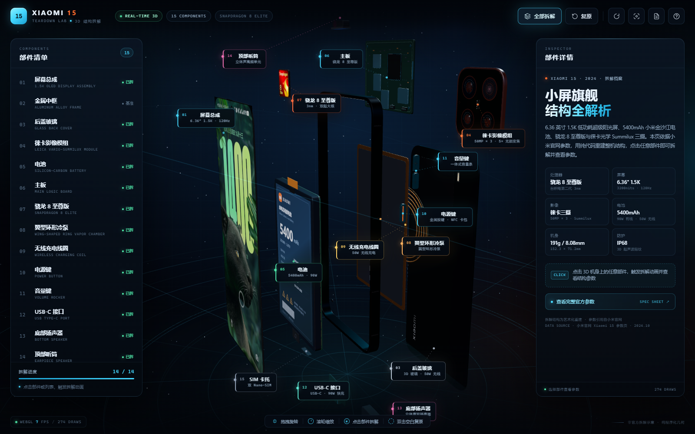
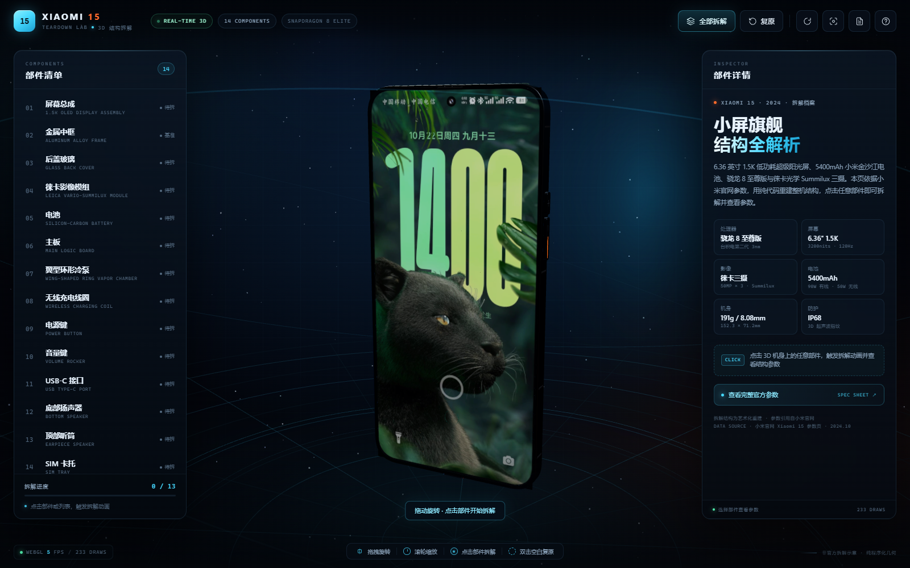
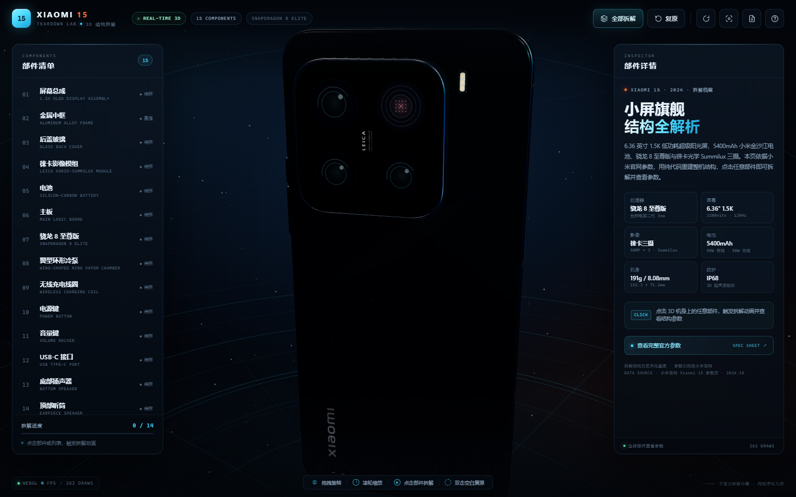
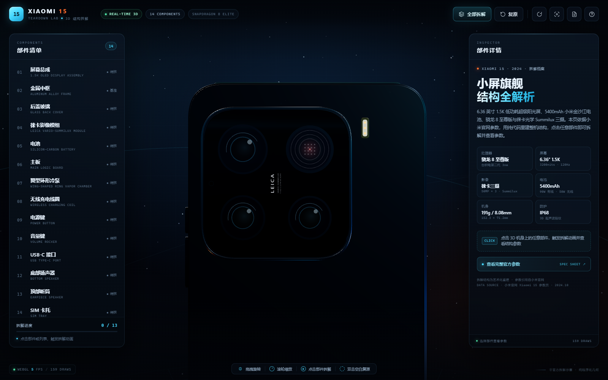
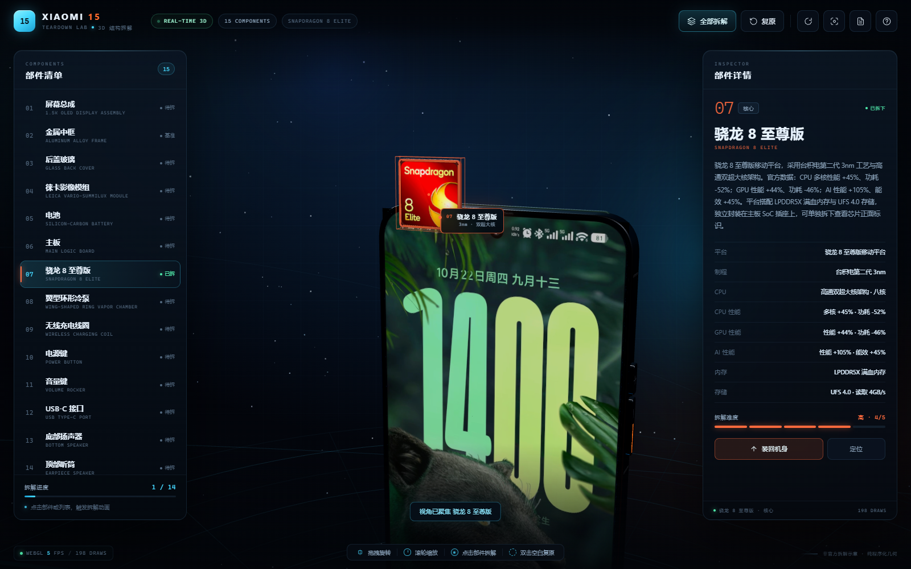
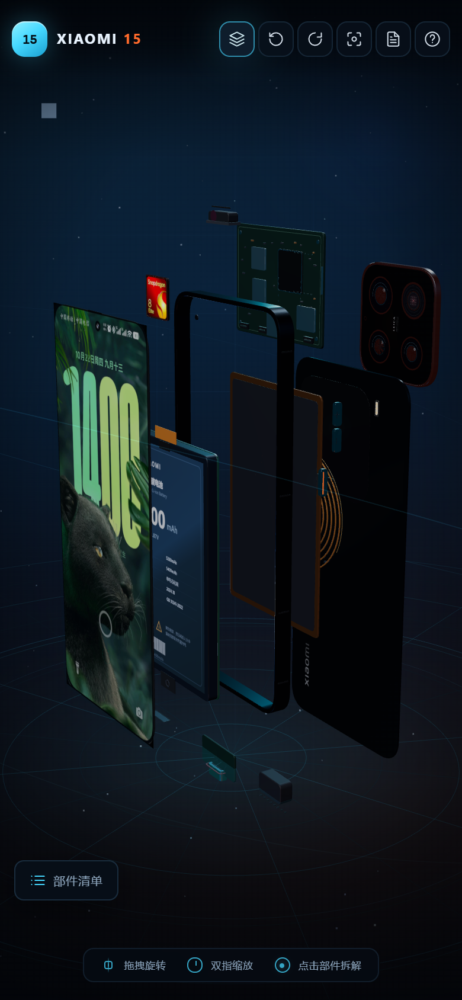
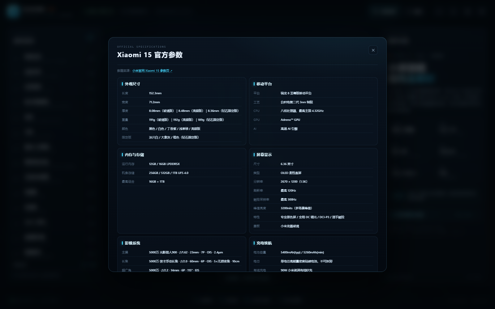

# Xiaomi 15 · 3D 拆解实验室

一个完全由代码生成的 Xiaomi 15 交互式 3D 拆解可视化页面。仅使用 **Three.js + 原生 HTML / CSS / JavaScript**，不加载任何外部 3D 模型；机身、摄像头、按键、接口、扬声器与电池标签全部在运行时程序化构建，锁屏壁纸使用用户提供的图片并以 data URL 内嵌。

**代码 MIT 开源；演示图片中的品牌/产品素材不纳入 MIT，详见 [THIRD_PARTY_NOTICES.md](THIRD_PARTY_NOTICES.md)。**















## 打开方式

直接双击 `index.html` 即可（无需服务器、无需联网）。Three.js r170 已转换为经典脚本并放在 `vendor/three.js`，因此 `file://` 协议下也能正常工作。

单文件分发版：`dist/Xiaomi15-3D-Teardown.html`，同样可以双击打开，零外部请求。

## 功能

- **精准结构还原**：铝合金中框、6.36″ 1.5K OLED 屏幕、徕卡三摄影像岛、5400mAh 硅碳电池、主板、独立可拆骁龙 8 至尊版芯片、翼型环形冷泵、无线充电线圈、电源键、一体式音量键、USB-C 接口、底部扬声器、顶部听筒、SIM 卡托，共 15 个部件。
- **官方外观细节**：后盖左下竖向 `XIAOMI` 字标（按提供的标识图改为圆体并加大）；左上角一整块凸起的**黑色**玻璃相机岛，约 **43 × 43.5mm、占机身宽度约 60%**，四角圆角与手机中框一致；内部 2×2 四开孔（主摄 / 红外与激光传感器 / 60mm 长焦 / 14mm 超广角）全部与玻璃齐平；右侧靠上一条独立竖向闪光灯；模组左侧有正面开孔麦克风；三行 LEICA 铭文在竖屏下旋转 90°，横持手机阅读。
- **点击拆解**：点击机身任意部件（或左侧清单、浮动标签），部件沿装配方向分离，并伴随高亮描边、发光与浮动参数标注。
- **自由视角**：左键拖拽旋转、滚轮 / 双指缩放、右键或 `Shift + 拖拽` 平移；自动旋转、重置视角。
- **部件详情**：右侧 Inspector 展示中英文名称、关键规格、结构说明、拆解难度与可维修性评分。
- **官方参数**：未选择部件时展示整机核心参数（骁龙 8 至尊版、1.5K 屏幕、5400mAh、徕卡三摄等）；点击「查看完整官方参数」可打开按小米官网参数页整理的完整规格表（外观、平台、屏幕、影像、充电、网络、音频、传感器等）。
- **部件清单 / 拆解进度**：15 个部件列表，实时统计 14 个可拆部件的拆解进度与 FPS / draw call。
- **操作引导**：底部操作提示、快捷键（`E` 全拆 / `R` 复原 / `Space` 自动旋转 / `H` 帮助 / `Esc` 取消）、完整帮助弹窗。
- **响应式**：桌面双栏 HUD；移动端隐藏侧栏，提供「部件清单」浮层、顶部官方参数入口与底部详情抽屉，自动适配窄屏拆解视图。

## 快捷键

| 按键 | 功能 |
| --- | --- |
| `E` | 全部拆解 |
| `R` | 复原整机 |
| `Space` | 自动旋转开关 |
| `H` | 打开 / 关闭帮助 |
| `Esc` | 关闭弹窗 / 取消选择 |

## 文件结构

```
xiaomi15-teardown/
├── index.html                 页面结构（HUD、面板、弹窗）
├── css/style.css              深色科技风 UI、玻璃拟态面板、标签与动画
├── js/screen-image.js         用户提供的完整屏幕图（data URL，离线内嵌）
├── js/logo-image.js           用户提供的 XIAOMI 标识（透明 PNG data URL）
├── js/chip-image.js           用户提供的骁龙 8 至尊版贴纸（data URL）
├── js/data.js                 产品文案、15 个部件的参数与拆解数据
├── js/model.js                全部程序化几何 / 材质 / Canvas 贴图
├── js/app.js                  场景、光照、自研轨道控制、交互、标签、HUD
├── assets/screen-lock.jpg     屏幕图裁切后的源文件
├── assets/logo-wordmark.png   标识图去背后源文件
├── assets/chip-snapdragon.png 骁龙芯片贴纸源文件
├── assets/README.md           演示素材授权说明
├── vendor/three.js            Three.js r170 经典脚本构建（MIT）
├── build-three.mjs            three module → classic script 转换脚本
├── build-single.mjs           生成单文件分发版
├── package.json               构建 / QA 脚本（运行时零依赖）
├── tools/embed-assets.mjs     从 assets/ 重新生成 base64 图片模块
├── LICENSE                    MIT（代码）
├── THIRD_PARTY_NOTICES.md     第三方素材与依赖声明
├── PUBLISHING.md              GitHub 发布 / Pages / Release 步骤
├── .github/workflows/pages.yml GitHub Pages 自动部署
├── skill/code-only-3d-teardown/  可复用 skill：纯代码 3D 产品拆解
├── dist/Xiaomi15-3D-Teardown.html  单文件版本（可直接分享）
└── qa/                        无头浏览器截图与交互回归脚本
```

## 技术说明

- **几何**：所有机身部件由 `Shape + ExtrudeGeometry` 的圆角板、`BoxGeometry`、`CylinderGeometry`、`TorusGeometry` 等组合而成；外壳为带孔圆角中框，镜头为多段金属环 + 虹彩镜片材质。
- **屏幕**：直接使用你提供的完整前面板图，裁掉外框后贴在 1.5K OLED 面板上；图内前置摄像头的位置与尺寸原样保留，不再叠加错误的 3D 开孔。屏幕图以 data URL 内嵌。
- **贴图 / 字体**：后盖 `XIAOMI` 字标直接使用你提供的标识图（去背后作为透明 PNG），不再用系统字体近似；徕卡铭牌、电池标签、扬声器网孔仍为 Canvas 绘制；骁龙芯片顶部使用你提供的红色 Snapdragon 8 Elite 贴纸。
- **材质 / 光照**：ACES Filmic 色调映射 + 程序化 PMREM 环境反射；金属中框、镜片、铜质冷泵分别使用不同金属度 / 粗糙度的 `MeshPhysicalMaterial`。
- **拆解动画**：每个部件独立缓动 + 延迟队列；相机模块、后盖、主板与骁龙芯片在拆解时旋转 180°，展示镜头、字标与芯片正面。
- **可拆芯片**：SoC 从主板中单独拆出，主板保留金色触点插座；芯片封装顶部使用你提供的 Snapdragon 8 Elite 贴纸，参数按官方性能图单列（3nm、双超大核、CPU/GPU/AI 提升与功耗数据、LPDDR5X、UFS 4.0）。
- **外观建模**：相机岛是一整块凸起的黑色玻璃模组，四个圆形开孔与玻璃齐平（单独镜头不再凸起），模组圆角与中框一致；右上角为红外/激光对焦传感器窗口，LEICA 三行铭文在竖屏中旋转 90°（横持阅读）；闪光灯独立为模组右侧靠上的竖向灯条；模组左侧有麦克风开孔；后盖字标使用你提供的 `XIAOMI` 标识，并上移、缩小、右移贴近参考图；顶部边框不开孔；底部为填充式 SIM 卡托（带缝隙与顶针孔），不是空槽。
- **后盖悬停**：不再叠加高饱和品牌色和矩形包围框，改为提高环境反射、降低粗糙度并淡入一层柔和斜向玻璃高光。
- **高亮**：按部件注册材质自发光状态，选中 / 悬停时叠加品牌色发光、脉冲描边盒与柔光 Sprite，不污染其它部件。
- **标注**：3D 锚点投影到屏幕坐标 + DOM 标签 + SVG 引线；标签自动避让、限制在双面板之间。
- **无网络依赖**：UI 字体使用系统字体；屏幕图、标识图、所有 JS 与 Three.js 均为本地或内嵌资源，可直接双击打开。

> 页面为艺术化结构重建，比例与内部堆叠参考公开资料，不代表官方工程数据。机型参数整理自 [小米官网 Xiaomi 15 参数页](https://www.mi.com/prod/xiaomi-15/specs)（外观尺寸、骁龙 8 至尊版、6.36″ 1.5K 屏幕、5400mAh 电池、徕卡三摄、90W + 50W 充电等），拆解结构仍为可视化重建。Xiaomi、Leica 等商标归其各自所有者。

## 配套 Skill

`skill/code-only-3d-teardown/` 是从本项目抽取的可复用 skill，面向“把真实产品做成纯代码 3D 拆解页”的任务：

- 官方图量比例、Three.js 离线化、程序化几何、爆炸/旋转、标签与参数面板
- 无头浏览器 QA、单文件打包、第三方素材授权隔离
- 本项目踩过的坑（相机模组比例、重复闪光灯、顶部误开孔、字标字体/方向、玻璃 hover 等）

安装到项目级 skill 目录：

```bash
mkdir -p .dsh/skills
cp -r skill/code-only-3d-teardown .dsh/skills/
```

本机已验证安装到当前工作区的 `.dsh/skills/code-only-3d-teardown`，DSH 会自动热加载。

## 开源与素材说明

- **代码**：MIT，见 [LICENSE](LICENSE)。
- **Three.js**：MIT，见 `vendor/three.js` 与 [THIRD_PARTY_NOTICES.md](THIRD_PARTY_NOTICES.md)。
- **屏幕图、XIAOMI 字标、Snapdragon 贴纸、预览图**：来自用户提供的演示素材，**不属于 MIT 授权范围**；相关商标/版权归小米、徕卡、高通等各自所有者。公开再分发前请确认授权，或按素材声明删除并替换为自制占位素材。
- 本项目与小米、徕卡、高通无关联，也未获其背书。

## 本地开发与校验

运行时不依赖 npm；只有 QA 需要 `playwright-core` 和本机 Chrome/Edge：

```bash
npm install
npm run embed       # 从 assets/ 重新生成 js/*-image.js（替换素材后使用）
npm run qa          # 桌面 + 移动端交互 / 标签 / 拆解回归
npm run qa:mobile   # 单独跑移动端截图
npm run build       # 重新生成 dist 单文件版
```

如果 Playwright 找不到浏览器，设置 `CHROME_PATH`；如果使用外部安装的 `playwright-core`，设置 `PLAYWRIGHT_MODULE` 或 `NODE_PATH`。

校验内容包括：无控制台错误、部件射线拾取、标签不与面板重叠、14/14 拆解进度、移动端部件清单与详情抽屉、窄屏拆解构图、单文件零外部请求等。
